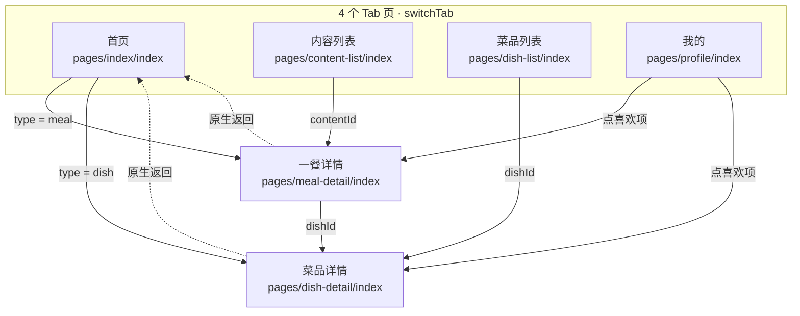

# 个人家常菜分享小程序 · PRD（v2.0）

> 面向 AI 开发的实施规格。v2.0 在 v1.0「静态展示」基础上，新增 **4 个 Tab、内容/菜品双列表、点赞、微信头像、本机存储**。
> 设计稿：Ardot 文件 `家常菜分享小程序 · 页面设计稿`（7 个画板：首页 / 一餐详情 / 菜品详情 / 信息架构说明板 v2.0 / 内容列表 / 菜品列表 / 我的）。
> **v2.0 完全取代 v1.0**；首页切分规则、色块占位、静态基础数据三条约定保持不变。

---

## 0. 一句话目标

做一个「个人厨房手记」式的小程序：**首页**用一条统一信息流展示菜品与一餐（前 5 条 Banner、其余瀑布流）；**内容列表**按日期戳 id 时间倒序展示每一餐、**菜品列表**按独立 id 展示每一道菜，两者都能点赞；**我的**展示微信头像与本机喜欢清单。

---

## 1. 范围与硬约束

| 项 | 约定 |
|---|---|
| 平台 | 微信小程序（现有工程 Taro 3.6 + React + TypeScript，直接复用） |
| 页面数 | **6 个**：4 个 Tab 页 + 2 个 `navigateTo` 详情页 |
| Tab | **4 项**：首页 / 内容列表 / 菜品列表 / 我的（见 §2） |
| 基础数据 | 全静态，本地 mock 文件；禁止 `wx.request` / 云开发 / 服务端数据（封面图允许 https 线上链接，见 §9） |
| 可写数据 | **只允许写本机 Storage**：点赞 id 数组、微信头像路径、昵称。无服务端、无账号、无 openid |
| 图片 | **默认全部用色块**（CSS 渐变）；可选 `coverImgUrl` 填 https 线上封面，留空则只显示色块；头像未授权时用默认人像色块 |
| 交互 | Banner 横滑、页面跳转、Tab 切换、**点赞**、头像/昵称授权填写 |
| 展示 | 对外展示 + 点赞；无登录、无评论、无上传、无搜索、无埋点 |

### 明确不做（Out of Scope）
评论、收藏（与点赞重复）、分享、上传/编辑内容、分类筛选、下拉刷新、分页加载、骨架屏、复杂动效、深色模式、多用户/云端同步、点赞数真实统计。

### 与现有工程的差异（开发必读）
- 现有 `src/app.config.ts` 注册 5 个页面 + 3 项 tabBar → **改为 6 页 + 4 项 tabBar**（建议自定义 tabBar，见 §2.2）。
- 现有 `src/types/recipe.ts` 含 `likes/favorites/comments/author` → 只保留 `likeCount`，其余互动字段移除；新增 `ContentItem` / `LocalStore`。
- 现有 `src/services/mock/recipes.ts` 使用 Unsplash 远程图片 → **不再使用**，改为 `coverKey` 色块；如需展示线上封面，统一走 `coverImgUrl`（仅 https，见 §9）。
- v1.0 的 `Meal` 实体**重命名为 `ContentItem`**，`m001` 式 id 全部废弃，改用日期戳 id。

---

## 2. 信息架构 / 页面分布



| # | 页面 | 路径 | 类型 | 导航栏标题 |
|---|---|---|---|---|
| 01 | 首页 | `pages/index/index` | Tab 1 / 启动页 | 林小厨家常食记 |
| 02 | 内容列表 | `pages/content-list/index` | Tab 2 | 内容列表 |
| 03 | 菜品列表 | `pages/dish-list/index` | Tab 3 | 菜品列表 |
| 04 | 我的 | `pages/profile/index` | Tab 4 | 我的 |
| 05 | 一餐详情 | `pages/meal-detail/index?id=202611081` | 子页，带返回 | 这一餐 |
| 06 | 菜品详情 | `pages/dish-detail/index?id=d001` | 子页，带返回 | 菜品详情 |

### 2.1 `app.config.ts` 目标配置

```ts
export default defineAppConfig({
  pages: [
    'pages/index/index',
    'pages/content-list/index',
    'pages/dish-list/index',
    'pages/profile/index',
    'pages/meal-detail/index',
    'pages/dish-detail/index',
  ],
  window: {
    backgroundTextStyle: 'light',
    navigationBarBackgroundColor: '#F8F3EC',
    navigationBarTitleText: '林小厨家常食记',
    navigationBarTextStyle: 'black',
  },
  tabBar: {                       // ★ 实现采用原生 tabBar，见 2.2
    color: '#9A8A73',
    selectedColor: '#E07856',
    backgroundColor: '#FFFFFF',
    borderStyle: 'white',
    list: [
      { pagePath: 'pages/index/index',        text: '首页',
        iconPath: 'assets/tabbar/home.png',   selectedIconPath: 'assets/tabbar/home-active.png' },
      { pagePath: 'pages/content-list/index', text: '内容列表',
        iconPath: 'assets/tabbar/content.png', selectedIconPath: 'assets/tabbar/content-active.png' },
      { pagePath: 'pages/dish-list/index',    text: '菜品列表',
        iconPath: 'assets/tabbar/dish.png',   selectedIconPath: 'assets/tabbar/dish-active.png' },
      { pagePath: 'pages/profile/index',      text: '我的',
        iconPath: 'assets/tabbar/profile.png', selectedIconPath: 'assets/tabbar/profile-active.png' },
    ],
  },
})
```

### 2.2 TabBar 实现方案（已落地：原生 tabBar + 本地线性 PNG）

**最终实现采用 v2.0 原文中的备选方案**：`app.config.ts` 使用微信原生 `tabBar`（不设 `custom`），4 项各配 2 张 81×81 线性 PNG 图标（未选中 `#9A8A73` / 选中 `#E07856`），资源位于 `src/assets/tabbar/`，构建时自动拷贝到 `dist/assets/tabbar/`。

采用原因（对原「自定义 tabBar」建议的修正）：
- Taro 3.6 的自定义 tabBar **在每个 Tab 页各自创建组件实例、状态不共享**，还需给每个 Tab 页 `config` 声明 `usingComponents`，并额外处理选中态同步与首屏闪烁；
- 设计稿的 4 个线性图标可以离线导出为两套 PNG，视觉一致度接近，且没有上述运行时风险；
- 原生 tabBar 的切换由微信框架处理，**代码里不需要 `switchTab` 调用**，也不需要在页面里手工渲染 TabBar 组件；只有跳两个详情子页才用 `navigateTo`。

对验收清单的影响：§10 中「Tab 之间用 `switchTab`」一条按原生 tabBar 语义视为满足；「4 个 Tab 页底部都有 TabBar 且当前项正确高亮、详情页没有」由原生框架保证。若后续要换成自定义 tabBar，只需新增 `src/custom-tab-bar/index.tsx`、给 4 个 Tab 页加 `usingComponents`、删掉 `iconPath` 配置，页面业务代码无需改动。

---

## 3. 模块结构（逐页）

### 3.1 首页 `M1`（不变）

| 模块 ID | 模块 | 数据来源 | 内容与规则 |
|---|---|---|---|
| M1-1 | 品牌头 | `SITE_META` | Kicker + 主标题 + 简介 + 记录总数 |
| M1-2 | Banner 区块 | `feed.slice(0, 5)` | 标题「本周精选」+ 进度「01 / 05」+ 5 个分页点 |
| M1-3 | Banner 轮播 | 同上 5 条 | 主卡 280×212，露出下一张约 50px；色块背景 + 类型徽标 + 标题 + 副标题 + 日期 |
| M1-4 | 瀑布流区块 | `feed.slice(5)` | 标题「全部记录」+ 条数 + 类型图例 |
| M1-5 | 双列瀑布流 | 同上 8 条 | 两列 166px，列间距 11px，卡间距 12px，`coverHeight` 制造错落 |
| M1-6 | 页脚 / TabBar | 常量 | 页脚文字 + 底部 4 项 TabBar |

**Banner 与瀑布流同构（核心约束不变）**：同一个 `FeedItem[]`、同一个 `FeedCard`，只有 `variant` 不同。禁止为 Banner 单独定义数据结构。

> 首页卡片**不显示点赞按钮**（信息流保持简洁）。点赞入口共 4 处：内容列表、菜品列表、一餐详情、菜品详情，均复用同一个 `LikeButton` + `useLikes`。

### 3.2 内容列表 `M2`（新增，Tab 2）

| 模块 ID | 模块 | 数据来源 | 内容与规则 |
|---|---|---|---|
| M2-1 | 页头 | `SITE_META` + `contents.length` | Kicker「按时间记录 · 每餐一记」+ 标题「全部内容」+ id 规则说明 + 「共 7 条 · 按时间倒序」 |
| M2-2 | 点赞提示 | 常量 | 「点右下角爱心即可喜欢 · 状态保存在本机」 |
| M2-3 | 内容卡列表 | `contents` 按 id 数值倒序 | 每张卡 = 左 84×84 封面色块 + 右侧（id + 类型 + 道数 / 标题 / 一行描述）+ 右下角点赞按钮（心形 + 数字） |
| M2-4 | 页脚 / TabBar | 常量 | 「向下滚动查看更多 · 数据来自本地」+ TabBar（第 2 项选中） |

卡片显示 example：`202611081 · 一餐 · 3 道菜` / `周末的三菜一汤` / `慢一点的周六，做了三道想吃很久的家常菜` / `♡ 12`。点击卡片进 `meal-detail?id=<contentId>`；**点心形不触发跳转**（阻止冒泡）。

### 3.3 菜品列表 `M3`（新增，Tab 3）

| 模块 ID | 模块 | 数据来源 | 内容与规则 |
|---|---|---|---|
| M3-1 | 页头 | `dishes.length` | Kicker「一道一味 · 单独成卡」+ 标题「全部菜品」+ id 说明 + 「共 10 道」 |
| M3-2 | 点赞提示 | 常量 | 「点封面右上角爱心即可喜欢 · 状态保存在本机」 |
| M3-3 | 双列菜品网格 | `dishes` | 两列 166px，等高卡片：封面色块 135px（右上角叠加圆形点赞按钮）+ 菜名 + 一句话描述 + 「id · N 人喜欢」 |
| M3-4 | 页脚 / TabBar | 常量 | 页脚 + TabBar（第 3 项选中） |

**菜品必须同时具备**：独立 `id`、封面色块（后续 → 本地图片）、`description` 一句话描述、点赞。已点赞项的「id · N 人喜欢 · 已喜欢」用强调色。

### 3.4 我的 `M4`（新增，Tab 4）

| 模块 ID | 模块 | 数据来源 | 内容与规则 |
|---|---|---|---|
| M4-1 | 个人信息卡 | `LocalStore.profile` | 暖橙渐变底；68×68 圆形微信头像（未授权显示默认人像）+ 昵称 + 「点击头像更换 · 微信授权填写」 |
| M4-2 | 喜欢统计 | `LocalStore` 两个数组长度 | 两个数字：「喜欢的内容」/「喜欢的菜品」 |
| M4-3 | 存储说明 | 常量 | 「头像与昵称仅保存在本机，不上传服务器」 |
| M4-4 | 喜欢的菜品 | `likedDishIds` → 反查 `dishes` | 行卡：48×48 色块 + 菜名 + `id · 描述` + 实心橙心；标题右侧「近 2 / 4 道 · 查看全部 ›」 |
| M4-5 | 喜欢的内容 | `likedContentIds` → 反查 `contents` | 行卡：48×48 色块 + 标题 + `id · 日期` + 实心橙心；标题右侧「近 2 / 3 条 · 查看全部 ›」 |
| M4-6 | 页脚 / TabBar | 常量 | 「全部数据仅存本机（Storage）· 清除小程序数据后会重置」+ TabBar（第 4 项选中） |

- 默认每组只渲染**最近 2 条**（按 id 倒序），「查看全部 ›」为**同页展开**全部已喜欢项，不新增页面。
- 两组都为空时分别显示空态「还没有喜欢的菜品 / 内容，去列表页点个爱心吧」，并保留 TabBar。
- 反查不到实体（mock 数据被删）时静默跳过该项，不报错、不显示空白卡。

### 3.5 一餐详情 `M5`（v1 保留 + 点赞）

标题区 / 元信息条 / 这顿饭小记 / 菜品列表同 v1；**封面右上角新增点赞胶囊**（`♡ 12` / `♥ 13`），绑定该 `ContentItem.id`。

### 3.6 菜品详情 `M6`（v1 保留 + 点赞）

封面 / 图集 / 关于这道菜 / 食材 / 步骤同 v1；**封面右上角新增点赞胶囊**（`♥ 29`），绑定该 `Dish.id`。`Dish.description` 作为副标题，`story` 作为详细介绍，两者都要实现。

---

## 4. 数据模型（TypeScript）

建议文件：`src/types/content.ts`、`src/services/mock/feed.ts` / `contents.ts` / `dishes.ts` / `covers.ts`、`src/services/local-store.ts`、`src/hooks/useLikes.ts`。

```ts
// ---------- 基础 ----------
export type FeedItemType = 'dish' | 'meal'   // meal → ContentItem（一餐）
export type Difficulty = '简单' | '中等'
export type MealType = '早餐' | '午餐' | '晚餐'
export type ColorKey =
  | 'warm-orange' | 'tomato-red' | 'sage' | 'leaf-green'
  | 'wheat-gold' | 'terracotta' | 'chili' | 'oat'

export interface Ingredient { name: string; amount: string }
export interface Step { index: number; description: string }

// ---------- 内容（一餐）：id = 日期时间戳 ----------
export interface ContentItem {
  id: string                 // '202611081' = 2026.11.08 第 1 条（★ 不是时间戳毫秒数）
  date: string               // '2026.11.08'
  mealType: MealType
  weekday: string
  title: string
  subtitle: string
  coverKey: ColorKey
  totalMinutes: number
  servings: number
  tags: string[]
  note: string[]             // 这顿饭小记，1~2 段
  dishIds: string[]          // ★ 一餐包含多个菜品，只存 id，不复制实体
  likeCount: number          // 静态基数，本机点赞在此基础上 +1
}

// ---------- 菜品：独立 id 命名空间 ----------
export interface Dish {
  id: string                 // 'd001' … 'd010'
  title: string
  description: string        // ★ 一句话描述（列表卡用）
  subtitle: string           // 详情页副标题
  coverKey: ColorKey
  images: ColorKey[]         // 图集色块，通常 3 张
  category: string
  tags: string[]
  duration: number
  difficulty: Difficulty
  servings: number
  date: string
  story: string[]            // ★ 详细介绍，2 段（详情页主体）
  ingredients: Ingredient[]
  steps: Step[]
  likeCount: number
}

// ---------- 首页统一内容流（v1 不变） ----------
export interface FeedItem {
  id: string                 // 'f001'…'f013'
  type: FeedItemType
  refId: string              // → ContentItem.id（type=meal）或 Dish.id（type=dish）
  title: string
  subtitle: string
  coverKey: ColorKey
  date: string
  meta: string
  tags: string[]
  coverHeight: number        // 瀑布流错落高度；Banner 忽略
}

// ---------- 本机可写数据 ----------
export interface LocalStore {
  likedContentIds: string[]  // ContentItem.id[]
  likedDishIds: string[]     // Dish.id[]
  profile: {
    avatarUrl: string        // 本地持久路径，'' 表示未授权
    nickName: string         // '' 表示未填写，回退显示「林小厨」
  }
}

export const EMPTY_STORE: LocalStore = {
  likedContentIds: [],
  likedDishIds: [],
  profile: { avatarUrl: '', nickName: '' },
}
```

**色块映射**（`covers.ts`，替换真实图片时只改这里）

```ts
export const COLOR_BLOCKS: Record<ColorKey, [string, string]> = {
  'warm-orange': ['#EDAD73', '#D9804D'],
  'tomato-red':  ['#DE6B4F', '#B84238'],
  'sage':        ['#9EB88C', '#6B8C66'],
  'leaf-green':  ['#8CB37A', '#578057'],
  'wheat-gold':  ['#F0D182', '#D9A852'],
  'terracotta':  ['#CC7354', '#9E4738'],
  'chili':       ['#C25440', '#8C332E'],
  'oat':         ['#D9B587', '#AD8057'],
}
// 后续：把 COLOR_BLOCKS 换成 LOCAL_IMAGES，<ColorBlock> 内部改为渲染 <Image>，页面零改动
```

---

## 5. 核心规则（AI 必须严格实现）

### 5.1 首页切分（不变）
```ts
const BANNER_SIZE = 5
const bannerItems = feed.slice(0, BANNER_SIZE)
const waterfallItems = feed.slice(BANNER_SIZE)
```
`feed.length <= 5` 时瀑布流显示空态「还没有更多记录」，不得重复渲染。保持 `feed` 原顺序，禁止排序 / 按 type 分组。Banner 与瀑布流共用 `FeedCard`。

### 5.2 瀑布流分列（不变）
「最短列优先」：`heights[0] <= heights[1] ? 0 : 1`，`heights[i] += coverHeight + 74`。渲染两个纵向列，列内 `gap: 12`，列间距 `11`。

### 5.3 ID 规则（★ v2.0 新增，重点）

```ts
// 内容 id = yyyymmdd(8位) + 当天序号(1位)，共 9 位
// 202611081 → 2026-11-08 第 1 条；202611082 → 同日第 2 条
export function makeContentId(date: Date, seq: number): string {
  const y = date.getFullYear()
  const m = String(date.getMonth() + 1).padStart(2, '0')
  const d = String(date.getDate()).padStart(2, '0')
  return `${y}${m}${d}${seq}`          // seq 1~9 为 1 位；≥10 自然进位为 2 位（10 位 id）
}
```

- **排序必须用数值降序，不能用字符串倒序**：
  ```ts
  const sorted = [...contents].sort((a, b) => Number(b.id) - Number(a.id))
  ```
  原因：9 位与 10 位 id 混排时，`'2026110810'` 与 `'202611089'` 按字符串比较会错位；数值比较才正确。
- id 全局唯一、稳定，**禁止用数组下标当 id**（数据增删会导致点赞错绑）。
- 菜品 id 为 `d` + 3 位序号（`d001`…`d010`），与内容 id 分属两个命名空间；`FeedItem.refId` 必须配合 `type` 才能唯一定位实体。
- 路由参数原样传 id 字符串，不要 `parseInt`（`202611081` 虽可转数字，但 10 位 id 与菜品 `d001` 混合会出错）。

### 5.4 路由分流
```ts
function onCardTap(item: FeedItem) {
  const url = item.type === 'meal'
    ? `/pages/meal-detail/index?id=${item.refId}`
    : `/pages/dish-detail/index?id=${item.refId}`
  Taro.navigateTo({ url })
}
```
内容列表 → `meal-detail?id=<contentId>`；菜品列表 / 一餐详情菜品行 → `dish-detail?id=<dishId>`；「我的」喜欢项同理。Tab 之间只能 `Taro.switchTab`。id 找不到时渲染「内容不存在」并保留返回，不得白屏。

### 5.5 点赞与本机存储（★ v2.0 新增）

```ts
const STORAGE_KEY = 'meal-daily:local:v1'   // 单个 key

export function readStore(): LocalStore {
  try {
    const v = Taro.getStorageSync(STORAGE_KEY)
    return v ? { ...EMPTY_STORE, ...v } : EMPTY_STORE
  } catch { return EMPTY_STORE }
}
export function writeStore(s: LocalStore) {
  Taro.setStorageSync(STORAGE_KEY, s)
}
```

- 点赞**只存 id 数组**，不存实体、不存计数。写前去重，取消点赞用 `filter` 移除。
- 展示数字统一由函数计算，**禁止把点赞后的数字写回 mock**：
  ```ts
  displayLikes = baseLikeCount + (isLiked ? 1 : 0)
  ```
- 点赞后 `writeStore` 立即生效，并同步所有页面：推荐用 `useLikes` hook（React Context / 轻量全局 store）+ 各 Tab 页 `useDidShow` 重读 Storage；不可只更新当前组件 state。
- `LikeButton` 两态：未点赞 = 灰色空心心 `#9A8A73` + 白色半透明圆底；已点赞 = 实心橙 `#E07856`。列表卡上的点赞必须 `stopPropagation`，不触发卡片跳转。
- Storage 限制：单 key ≤ 1MB、总 ≤ 10MB；本方案只存十几个 id 字符串，远低于上限。清除小程序数据 / 换设备会重置，属预期行为，需在「我的」页明示。

### 5.6 微信头像与昵称（★ v2.0 新增，易踩坑）

- **不要使用 `Taro.getUserProfile` / `wx.getUserInfo`**：这两个接口已收回，无法静默拿到头像昵称，也不做登录、不取 openid。
- 用微信「头像昵称填写能力」，由用户主动选择：
  ```tsx
  <Button openType="chooseAvatar" onChooseAvatar={onChooseAvatar}>
    <Image src={avatarUrl || DEFAULT_AVATAR} />
  </Button>
  <Input type="nickname" value={nickName} onBlur={onNicknameBlur} placeholder="点击填写昵称" />
  ```
- `onChooseAvatar` 返回的 `avatarUrl` 是**临时文件路径**，重启后失效。必须持久化为本地文件后再存路径：
  ```ts
  const fs = Taro.getFileSystemManager()
  const target = `${Taro.env.USER_DATA_PATH}/avatar.png`
  fs.saveFile({ tempFilePath: e.detail.avatarUrl, filePath: target })
  writeStore({ ...store, profile: { ...store.profile, avatarUrl: target } })
  ```
  `saveFile` 失败时回退：仍写临时路径 + 提示用户「头像可能在重启后需重新选择」。
- 未授权 / 未填写时：头像显示默认人像色块，昵称回退「林小厨」。**不得弹强制授权、不得阻断浏览**。
- 头像仅存本机，不上传任何服务器。

### 5.7 数据一致性校验（开发时加本地函数）
- 每条 `FeedItem.refId` 必须命中 `contents` / `dishes`，且 `type` 与目标实体一致。
- 每个 `ContentItem.dishIds` 中的 id 必须存在于 `dishes`。
- 所有 id 在各自命名空间内唯一；`coverKey` 必须是 `COLOR_BLOCKS` 合法键。
- `Dish.steps[].index` 从 1 连续递增；`LocalStore` 里的 id 允许指向已删除数据（渲染时跳过）。

---

## 6. 静态数据规模（按设计稿）

| 数据集 | 数量 | 说明 |
|---|---|---|
| `feed` | **13** | 5 条 Banner + 8 条瀑布流；`dish` 与 `meal` 混合；**编辑排序（精选优先）** |
| `contents` | **7** | 日期戳 id；**按 id 数值倒序**用于内容列表 |
| `dishes` | **10** | `d001`…`d010`，每条必须有 `description`；`d001 番茄炒鸡蛋` 需填完整 story / ingredients / steps |

> `feed` 是编辑排序，`contents` 是时间排序，**两者互不影响**，不要试图用一个数组同时满足两种顺序。

`contents` 示例（7 条）：

| id | 日期 / 餐次 | 标题 | 道数 |
|---|---|---|---|
| 202611081 | 11.08 晚餐 | 周末的三菜一汤 | 3 |
| 202611071 | 11.07 晚餐 | 立冬的一锅炖菜 | 2 |
| 202611061 | 11.06 午餐 | 一个人的周末午餐 | 4 |
| 202611021 | 11.02 晚餐 | 入秋的第一锅热汤 | 3 |
| 202610281 | 10.28 晚餐 | 家里来客人的一桌菜 | 5 |
| 202610251 | 10.25 晚餐 | 工作日快手晚餐 | 2 |
| 202610061 | 10.06 晚餐 | 中秋家宴 | 5 |

`feed` 前 5 条：`f001 → 202611081(meal)` / `f002 → d007 回锅肉(dish)` / `f003 → 202611071(meal)` / `f004 → d006 葱油拌面(dish)` / `f005 → 202610061(meal)`。

> **实现修正**：以设计稿 `06 菜品列表` 画板为准，`d006 = 葱油拌面`、`d005 = 冬瓜排骨汤`；因此把「回锅肉」顺延为 `d007`，并补 `d008 凉拌黄瓜 / d009 香菇鸡肉饭 / d010 可乐鸡翅` 凑齐 10 道。v2.0 原文中 `d006 回锅肉 / d007 葱油拌面` 的写法已作废。
`feed` 后 8 条：`202611061(meal)` → `d001 番茄炒鸡蛋(dish)` → `202611021(meal)` → `d002 蒜蓉西兰花(dish)` → `d003 蛋炒饭(dish)` → `202610281(meal)` → `d004 麻婆豆腐(dish)` → `202610251(meal)`。

一餐 → 菜品关系示例：
- `202611081` → `[d001 番茄炒鸡蛋, d002 蒜蓉西兰花, d005 冬瓜排骨汤]`
- `202610281` → `[d006, d004, d001, d002, d005]`（5 道）

本机点赞示例（「我的」页设计稿所展示的初始态，仅用于视觉稿，**不要写进 mock**）：
`likedDishIds = ['d002','d005', ...]`、`likedContentIds = ['202611061','202610281', ...]`。

---

## 7. 组件拆分建议

| 组件 / 模块 | 职责 | props / 输入 |
|---|---|---|
| `ColorBlock` | 色块占位；后续一行切换本地 `Image` | `colorKey`, `width`, `height`, `radius` |
| `FeedCard` | 首页唯一卡片，Banner / 瀑布流共用 | `item: FeedItem`, `variant`, `onTap` |
| `BannerSwiper` / `MasonryFeed` | 5 条 Swiper + 分页点 / 双列分列 | `items: FeedItem[]` |
| `ContentCard` | 内容列表行（id + 描述 + 点赞） | `item: ContentItem`, `liked`, `onTap`, `onLike` |
| `DishCard` | 菜品列表网格卡（id + 色块 + 描述 + 点赞） | `dish: Dish`, `liked`, `onTap`, `onLike` |
| `LikeButton` | 两种形态（列表小按钮 / 详情胶囊） | `liked`, `count`, `variant`, `onToggle` |
| `LikedRow` | 「我的」页喜欢项行 | `item`, `kind: 'dish' \| 'content'`, `onTap` |
| `SectionTitle` / `TagList` / `DishRow` | 区块标题 / 标签 / 一餐详情菜品行 | — |
| `custom-tab-bar` | 4 项 TabBar + 选中态 + 安全区 | 读当前路由 |
| `local-store.ts` / `useLikes` | Storage 读写、点赞状态与跨页同步 | `STORAGE_KEY` |

页面直接从 mock `import` 常量；**不需要请求层 / 后端 / 状态管理库**，`useLikes` 用 Context 足够。

---

## 8. 设计 Token（px → rpx：设计稿 px × 2）

| 类别 | 值 |
|---|---|
| 画布 / 卡片 / 分组底 / 行底 | `#F8F3EC` / `#FFFFFF` / `#F2EBDF` / `#FAF6EE` |
| 主 / 次 / 弱文字 | `#2A1F14` / `#6B5B47` / `#9A8A73` |
| 强调（Kicker、步骤序号、**Tab 选中、已点赞**） | `#E07856`；辅强调 `#F4A261` |
| 内容（一餐）类型色 | `#C05A3E` |
| 菜品类型色 / 标签底 | `#6E8C63` / `#EDF2E6` |
| **未点赞心形** | 描边 `#9A8A73`，1.4px，白色圆底 90% 不透明 |
| 边框 / TabBar 顶分割线 | `#E8DCC8` 1px |
| 标题字体 / 正文字体 | `Source Han Serif CN Bold` / `Noto Sans SC`（数字用 `Inter`） |
| 字号 | 26 / 20 / 18 / 16 / 14 / 13 / 12 / 11 / 10 px → 52 / 40 / 36 / 32 / 28 / 26 / 24 / 22 / 20 rpx |
| 页面左右留白 | 16px → 32rpx |
| 模块间距 / 卡片间距 / 双列间距 | 16~24px / 12px / 11px |
| 圆角 | 大卡 / 个人卡 16px、卡片 14px、行卡 12px、标签 12px、色块 8~10px、头像 50% |
| 卡片阴影 | `0 2px 8px rgba(69,80,68,0.12)` |
| 状态栏 + 原生导航栏 | 62px + 44px（原生导航栏由小程序提供，设计稿仅作示意） |
| **TabBar** | 高 84px（内容 50 + 安全区 34），白底，图标 22px + 文字 10px |

> 设计稿右上角的微信小程序胶囊为系统 UI，无需实现；但顶部需预留安全区避免遮挡。

---

## 9. 图片资源约定

1. **默认色块**：所有内容图片位由 `<ColorBlock>` 渲染 CSS 渐变，`coverKey` 是默认标识。
2. **可选线上封面**：`FeedItem` / `ContentItem` / `Dish` 新增可选 `coverImgUrl`（默认 `''`）。填 `https://` 链接时，`<ColorBlock>` 与 Banner 卡片改用 `<Image mode="aspectFill">` 铺满；留空则完全回退到色块。同一个字段贯穿首页 Banner、瀑布流、两个列表页与两个详情页。
3. **Banner 可读性**：有图时叠一层由浅到深的暗色蒙层（`rgba(28,16,10,0.10)` → `0.74`），保证白色标题与角标在照片上仍可读；无图时不渲染蒙层与 `<Image>`。
4. 约束：只接受 `https://` 开头，禁止 http；同步脚本与 `validateMockData()` 双重校验。不引入 `wx.request`、不下载图片、不做本地图片打包，`content/` 里只存链接字符串。
5. 头像：「我的」页用微信授权的本地文件路径，未授权时显示默认人像色块。
6. 风险提示：第三方图床（如公众号 `mmbiz.qpic.cn`）可能有防盗链 / 域名白名单限制；真机若出现空白封面，需检查小程序后台 downloadFile 合法域名或换用可直连图床。

---

## 10. 验收清单（AI 自检）

- [ ] `app.config.ts` 为 6 个页面；`tabBar.list` 恰好 4 项，顺序为首页 / 内容列表 / 菜品列表 / 我的
- [ ] 4 个 Tab 页底部都有 TabBar 且当前项正确高亮；2 个详情页**没有** TabBar
- [ ] Tab 切换由原生 tabBar 处理（仅自定义方案才用 `switchTab`）；跳详情页用 `navigateTo`，返回正常
- [ ] 首页仍由单个 `feed` 驱动，`slice(0,5)` / `slice(5)` 各渲染一次，无重复条目
- [ ] 首页同时存在 `meal` / `dish` 卡片且都由 `FeedCard` 渲染；Banner 可横滑、5 个分页点同步
- [ ] 内容 id 为 9 位日期戳（`202611081` 格式），全局唯一；列表按 `Number(id)` 降序
- [ ] 菜品 id 独立（`d001`…），每条都有封面色块 + `description` + 点赞按钮
- [ ] 4 处点赞入口（内容列表 / 菜品列表 / 两个详情）共用 `useLikes`，状态与数字一致
- [ ] 点赞只写 id 数组到 `meal-daily:local:v1`；`displayLikes = likeCount + (liked ? 1 : 0)`
- [ ] 点赞后切到其他 Tab / 重新进入详情页，状态保持；点心形不触发卡片跳转
- [ ] 取消点赞后「我的」页对应项消失，两组为空时显示空态
- [ ] 头像用 `openType="chooseAvatar"` + `type="nickname"`，无 `getUserProfile`、无登录、无 openid
- [ ] 头像临时路径经 `saveFile` 持久化；未授权时显示默认人像且不阻断浏览
- [ ] 「我的」页按 id 反查 mock 渲染两个分组，取不到的 id 静默跳过；「查看全部」同页展开
- [ ] 全项目无 `wx.request`、无云开发、无远程图片 URL、无写服务端操作
- [ ] 所有内容图片位为色块，色值来自 `COLOR_BLOCKS`
- [ ] 传不存在的 `id` 时展示「内容不存在」且可返回，不白屏；`feed.length <= 5` 时瀑布流显示空态

---

## 11. 设计稿对照

| 画板 | 对应 PRD 章节 |
|---|---|
| `01 首页 · 内容流` | §3.1、§5.1、§5.2、TabBar §2.2 |
| `02 一餐详情页 · Meal Detail` | §3.5（含封面点赞胶囊） |
| `03 菜品详情页 · Dish Detail` | §3.6（含封面点赞胶囊） |
| `04 信息架构说明板 · Spec V2.0` | §2、§4、§5.3、§5.5、§5.6、§8（01~11 节） |
| `05 内容列表 · Content List` | §3.2、§5.3 |
| `06 菜品列表 · Dish List` | §3.3、§4 `Dish` |
| `07 我的 · Profile` | §3.4、§5.5、§5.6 |

> 设计稿中所有暖色渐变块 = 色块占位；文案为中文示意内容，可直接用于 mock 数据。

---

## 12. 待确认 / 已知取舍

1. **Tab 数量**：需求文字写「三个 tab」，但列出的是 4 项（首页、内容列表、菜品列表、我的）。本版按 **4 项**实现。
2. **「内容」的定义**：本版把「内容」理解为「一餐 / 内容记录」（`ContentItem`，日期戳 id），与「菜品」（`Dish`，独立 id）并列；因此首页 `type='meal'` 的卡片与内容列表指向同一实体。若你希望内容列表包含首页所有 13 条 `FeedItem`，需要把 `ContentItem` 换成 `FeedItem` 并给每条加日期戳 id，改动约 §3.2 / §4 / §6。
3. **id 序号位数**：示例 `202611111` 为 9 位（末位 1 位序号），单日最多 9 条；超过 9 条会自然变成 10 位 id，此时**必须用数值排序**（§5.3）。若希望一开始就避免混排，可改为固定 2 位序号（`2026111101`），但会与示例格式不一致。
4. **点赞数只在本机**：`likeCount` 是静态展示基数，用户点赞只影响自己看到的 +1，不会同步给别人，也不会累加到服务端。这是「无后端 + 数据存本地」的必然结果。
5. **首页卡片暂不点赞**：为保持信息流简洁，一期点赞入口限定 4 处（§3.1）。如需首页也能点赞，直接在 `FeedCard` 里复用 `LikeButton` 即可，数据层无需改动。
6. **头像持久化**：`chooseAvatar` 返回临时路径，必须 `saveFile`；若后续要跨设备同步头像，就需要后端，超出本版范围。
7. **TabBar 方案改用原生**：见 §2.2，已落地，不再使用 `custom: true`。
8. **初始点赞为空**：设计稿「我的」页的 `likedDishIds / likedContentIds` 只是视觉示意，按 §6 约定未写进 mock；首次安装两组均显示空态，符合 §10 验收。

---

## 13. 实现落地记录（2026-11-12 · v2.0 代码已完成）

### 13.1 工程结构

| 层 | 文件 |
|---|---|
| 配置 | `src/app.config.ts`（6 页 + 4 原生 tabBar）、`src/app.ts`（初始化 store + 数据自检）、`src/styles/_tokens.scss`、`src/app.scss` |
| 数据 | `src/types/content.ts`、`src/services/mock/{covers,contents,dishes,feed,generated,index}.ts`、`src/services/local-store.ts`、`src/services/likes.ts`、`src/store/useLikes.ts` |
| 组件 | `ColorBlock` / `LikeButton` / `FeedCard` / `BannerSwiper` / `MasonryFeed` / `ContentCard` / `DishCard` / `LikedRow` / `SectionTitle` / `EmptyHint`（均在 `src/components/`） |
| 页面 | `pages/index`、`pages/content-list`、`pages/dish-list`、`pages/profile`、`pages/meal-detail`、`pages/dish-detail` |
| 资源 | `src/assets/tabbar/*.png`（8 张，构建后位于 `dist/assets/tabbar/`） |
| 录入源 | `content/`（README + manifest + entries + dishes）、`scripts/sync-content.mjs` → `src/services/mock/generated.ts`，见 §14 |
| 测试 | `__tests__/index.test.js`（15 条规则测试，含静态录入通道 3 条） |

旧的「带饭 App」业务代码（搜索 / 分类 / 上传 / 模拟登录 / 评论 / Unsplash 外链 / 旧 service+store+types+组件）已整体移除，工程骨架（Taro 3.6 + React 18 + TS + zustand）保持不变。

### 13.2 已执行的校验

| 项 | 结果 |
|---|---|
| `npx tsc --noEmit` | **0 错误** |
| `yarn build:weapp` | **成功，0 警告**；`dist/app.json` 为 6 页 4 tab，6 个页面 wxml/wxss 齐全，8 张图标已拷贝 |
| `yarn test --runInBand` | **19 / 19 通过**（数据一致性、切分规则、静态录入通道、`coverImgUrl` 线上封面、ID 规则、引用完整性、点赞计数） |
| 静态数据自检 | `validateMockData()` 返回 `[]`；内置 13 条 + `content/` 录入 2 条 = 15 条，Banner 5 + 瀑布流 10 无重叠；内容 id 全为 9 位且数值降序；所有 `refId` / `dishIds` 命中，`coverImgUrl` 均为 https 或空 |
| 禁用项扫描 | 无 `wx.request` / `Taro.request`、无 `getUserProfile` / `getUserInfo`、无云开发、无旧页面引用；唯一外链是静态数据里的 https 封面图 URL，不发起任何网络请求 |

### 13.3 运行方式

```bash
yarn install
yarn content:sync   # 可选：单独同步 content/；dev / build / test 会自动执行
yarn dev:weapp      # 或 yarn build:weapp
```
用微信开发者工具打开项目根目录（`miniprogramRoot` 已指向 `./dist`）；`project.config.json` 的 `appid` 已配置为 `wx6851faae0a253c39`（林小厨家常食记）。

### 13.4 尚未覆盖（需真机 / IDE）

- 未在微信开发者工具模拟器或真机上跑过页面，视觉稿与真机渲染差异未实测；
- `chooseAvatar` / `nickname` 授权填写、`saveFile` 后重启头像是否保留、Storage 清除后重置，均需在真机验证；
- 未做 Banner 手势横滑、点赞跨 Tab 同步的交互实测（代码路径已通过类型与编译校验）；
- 未生成预览应用卡、未发布上线。

---

## 14. 静态内容录入通道（2026-11-12 追加）

**背景**：§6 的 13 条数据是「内置精选」，写死在 `src/services/mock/*.ts`。为了让后续录入不必改 TS 代码，新增一层人工编辑态。录入内容不会替换内置数据，而是**合并**进来。

### 14.1 为什么需要编译一步

微信小程序运行时**不能遍历目录、也不能读取包内 JSON**，所有展示数据必须编译进 JS。因此：

```
content/*.json（人工编辑）
      │  yarn content:sync
      ▼
scripts/sync-content.mjs → src/services/mock/generated.ts
      │  import { userContents / userDishes / userFeed }
      ▼
contents.ts / dishes.ts / feed.ts 合并 → 页面（首页 / 列表 / 详情 / 我的）
```

`content/` 不参与打包，`generated.ts` 是唯一产物，纳入版本管理。

### 14.2 目录与文件

| 文件 | 作用 |
|---|---|
| `content/README.md` | 录入手册（字段、命令、常见问题） |
| `content/manifest.json` | `pinned` 决定首页置顶顺序，**第一项 = 首页 Banner 第一张**；`excludeFromFeed` 只入库不上首页 |
| `content/entries/*.json` | 一餐（`ContentItem`），文件名 = id = `yyyymmdd` + 当天序号 |
| `content/dishes/*.json` | 菜品（`Dish`），文件名 = id = `d` + 3 位数字 |
| `_TEMPLATE.json` | 下划线开头，脚本跳过，仅供复制 |

当前示例：`content/entries/202611121.json`（被 pinned，位于 Banner 第 1 张）、`content/dishes/d011.json`（第 2 张卡片）。示例一餐引用了新菜 `d011` 和内置菜 `d008`，演示两种引用方式。

### 14.3 录入规则

1. 复制模板 → 改名成 id → 填 JSON → `yarn content:sync`。
2. 每个录入文件默认自动派生一张 `FeedItem` 卡片：`title / subtitle / coverKey / date` 取自实体，`meta / tags / coverHeight` 自动生成；可在 `feed` 覆盖块里改。**Banner 与瀑布流仍是同一个 `feed`、同一个 `FeedItem` 结构，§5.1 切分规则不变**。
3. 首页顺序：`manifest.pinned`（按数组顺序）→ 其余录入文件按 `date` 倒序 → 内置 13 条精选。
4. 实体同时进入 `contents` / `dishes`，因此内容列表、菜品列表、详情页、「我的」喜欢列表都能正常打开和点赞，不需要额外接线。
5. 脚本校验：文件名与 id 一致、id 格式、`date` 格式、色块名合法、必填字段、`steps.index` 连续、`feed.coverHeight` 类型、`coverImgUrl` 协议；引用完整性由 `validateMockData()` 与测试兜底。任一失败不写产物并打印文件名。
6. **线上封面 `coverImgUrl`**（§9）：JSON 里可选，默认 `""`。同步脚本给每个实体与首页卡片补默认值并校验必须是 `https://` 或空；生成文件 `generated.ts` 中可见该字段。两个示例 `entries/202611121.json`、`dishes/d011.json` 均已填公众号图片链接，Banner 第一张与「青菜鸡蛋面」卡片显示线上照片；未填链接的条目仍是色块。Banner、瀑布流、列表卡与两个详情页共用同一字段。

### 14.4 命令

```bash
yarn content:sync      # 只同步
yarn dev:weapp         # 通过 prebuild:weapp 自动同步后再 watch
yarn build:weapp       # 自动同步后构建
yarn test              # 通过 pretest 自动同步后跑测试
```

watch 模式运行期间新增 JSON 文件，需手动再跑一次 `yarn content:sync`。

### 14.5 当前结果

录入 2 个文件 → 1 条一餐 + 1 道菜 + 2 张首页卡片；最终 `feed` = 2 + 13 = 15 条，Banner 5 条、瀑布流 10 条，示例一餐固定在 Banner 第一张。删掉两个示例 JSON 并清空 `pinned` 后同步，即可回到纯内置数据。
